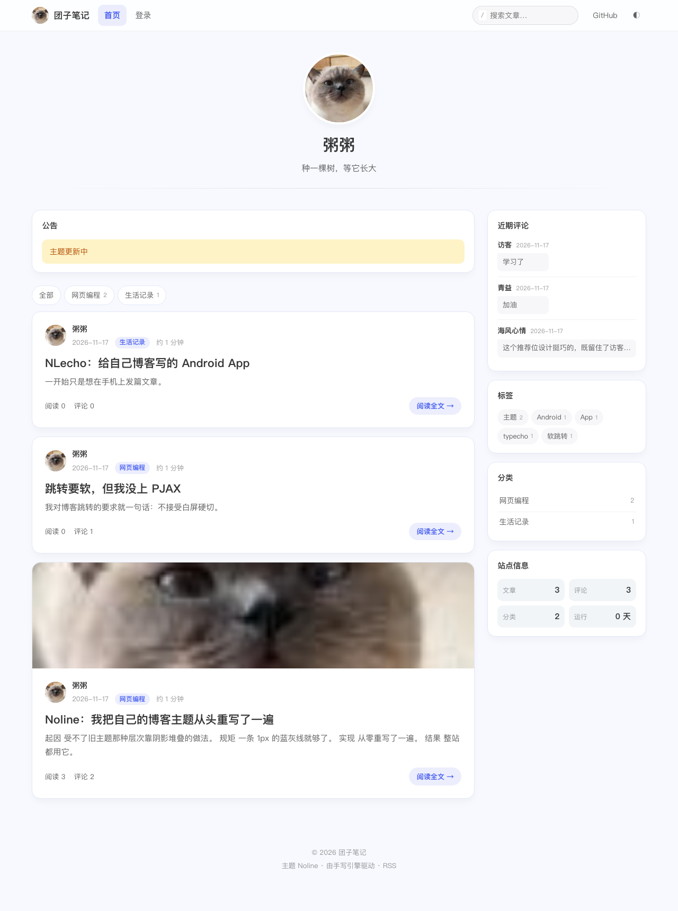
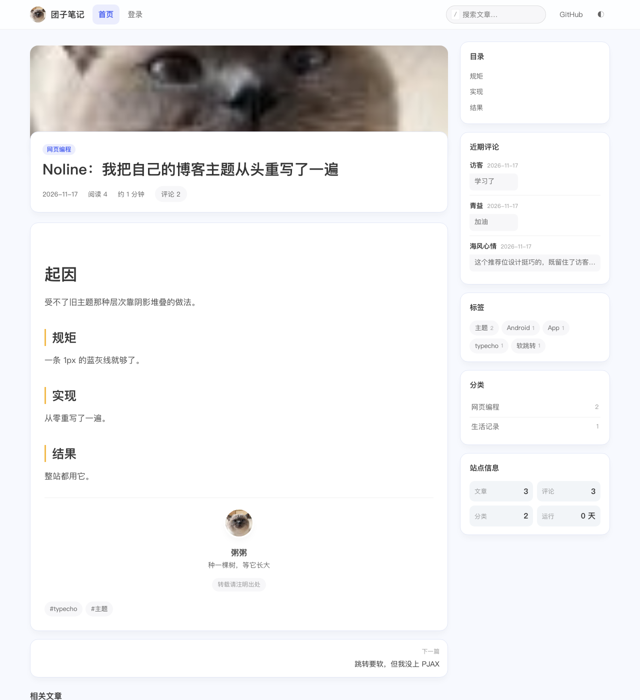

# Noline Blog

一个从零手写的博客引擎：**Node.js + Hono + SQLite**，自带主题系统，并复刻了 Noline（Typecho 主题）的设计与功能。除 `hono` 外，Markdown 渲染、模板引擎、密码哈希、会话、HTTP 桥接全部手写，没有 ORM、没有前端框架、没有构建工具链。

## 技术栈

| 层 | 选型 |
| --- | --- |
| 语言 | TypeScript |
| 运行时 | Node.js ≥ 22 |
| Web 框架 | Hono |
| 数据库 | SQLite（内置 `node:sqlite`） |
| 渲染 | 手写模板引擎 + 服务端渲染 |
| 认证 | `scrypt` 密码哈希 + HMAC 签名 Cookie |

## 功能

| 模块 | 内容 |
| --- | --- |
| 内容 | 文章增删改、Markdown、分类、标签、封面、阅读数 |
| 前台列表 | 分页、搜索、分类过滤、分类药丸条、卡片流 |
| 文章页 | 封面、目录 TOC、上一篇/下一篇、相关文章、版权卡、图片灯箱 |
| 评论 | 提交与展示、近期评论 |
| 主题 | 目录即主题、后台一键切换、每主题独立配置项、暗色模式 |
| 插件 | 目录即插件、钩子注入 HTML、生命周期事件、扩展路由、后台启停与配置 |
| 体验 | 暗色/浅色切换、返回顶部、软跳转（View Transitions 优先，降级淡出 + 进度条） |
| 其他 | RSS `/feed.xml`、站点统计、脏数据安全迁移 |

## 目录结构

| 路径 | 说明 |
| --- | --- |
| `src/` | 服务端入口（`index.ts`） |
| `src/db.ts` | SQLite 建表、迁移、查询封装 |
| `src/auth.ts` | scrypt 哈希、签名会话 |
| `src/lib/` | Markdown 渲染器、HTML 转义 |
| `src/theme/` | 模板引擎、主题扫描、配置存储、渲染 |
| `src/routes/` | 公开路由、后台路由 |
| `themes/` | 三套主题：`default` / `minimal` / `noline` |
| `plugins/` | 插件目录：`hello` / `sitemap` |
| `public/` | 后台样式 |
| `docs/` | README 截图 |
| `data/` | SQLite 数据文件（运行时生成，不入库） |

## 快速开始

| 步骤 | 命令 |
| --- | --- |
| 安装依赖 | `npm install` |
| 开发（热重载） | `npm run dev` |
| 构建 | `npm run build` |
| 生产运行 | `npm start` |
| 首次使用 | 打开 `http://localhost:3000/admin/setup` 创建管理员 |

## 部署

| 方式 | 命令 |
| --- | --- |
| 本地生产 | `npm ci && npm run build && npm start` |
| Docker 构建 | `docker build -t noline-blog .` |
| Docker 运行 | `docker run -d -p 3000:3000 -v "$PWD/data":/app/data --name noline-blog noline-blog` |
| 数据持久化 | 把宿主目录挂载到 `/app/data`（SQLite 文件与会话密钥都在这里，务必持久化） |
| 端口 | 通过环境变量 `PORT` 调整，默认 `3000` |

## 主题

| 主题 | 说明 |
| --- | --- |
| `default` | 暖阳：暖色温、卡片式文章流 |
| `minimal` | 极简：白纸黑字、衬线标题 |
| `noline` | 复刻 zhouzhou.work 的 Noline：蓝灰扁平、1px 发丝线、浅色/暗色双主题 |

新增主题：在 `themes/<name>/` 放置 `theme.json`、`header.html`、`footer.html`、`index.html`、`post.html`、`sidebar.html`、`style.css`，后台「主题」页会自动扫描到。

| 模板语法 | 含义 |
| --- | --- |
| `{{name}}` / `{{a.b.c}}` | 插值（自动 HTML 转义） |
| `{{{name}}}` | 插值（原始 HTML） |
| `{{#if x}}…{{else}}…{{/if}}` | 条件 |
| `{{#each list}}…{{else}}…{{/each}}` | 循环 |
| `{{> partial}}` | 引入片段 |

## 插件

插件放在 `plugins/<name>/`：`plugin.json`（元数据 + `settings` 配置项）+ `index.mjs`（默认导出插件对象）。后台「插件」页启用/停用/配置。

| 能力 | 说明 |
| --- | --- |
| `hooks` | `head`、`body` 返回字符串注入到 `</head>` / `</body>` 前，参数含 `config`（本插件配置）与 `escape` |
| `events` | `post:viewed`、`comment:created` 等生命周期事件，用于统计、日志等副作用 |
| `routes` | `routes(app, { api })` 注册自定义路由（启动时挂载，启用后需重启生效） |

| 示例插件 | 说明 |
| --- | --- |
| `hello` | 页脚注入可配置问候语；监听 `comment:created` 打印日志 |
| `sitemap` | 扩展 `/sitemap.xml`，列出首页与所有文章 |

## 许可

MIT
